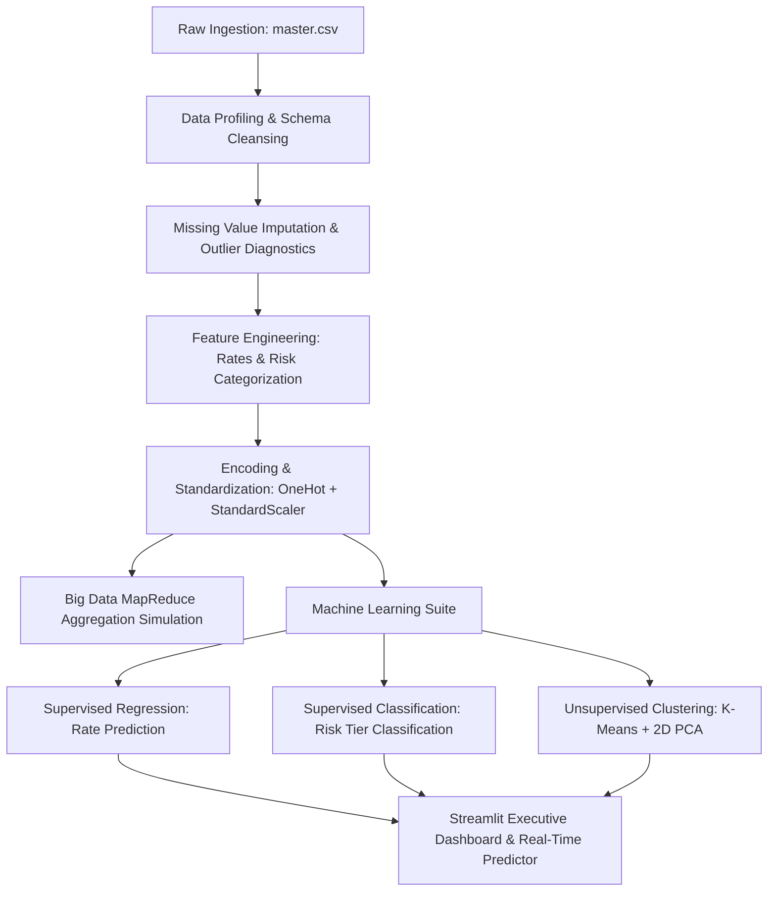

# 📈 Global Socio-Demographic & Suicide Analytics: Big Data Engineering & Predictive ML Pipeline

An end-to-end **Big Data Analytics (BDA)** project built using `master.csv`. It features an automated data preprocessing pipeline, distributed MapReduce simulation, multi-model supervised machine learning (regression and classification), unsupervised clustering via PCA, and an interactive Streamlit dashboard.

---

## 🏛️ System Architecture



---

## 📁 Project Directory Structure

```text
Achu BDA/
│
├── master.csv                   # Input socioeconomic & demographic dataset
├── app.py                       # Streamlit web dashboard application
├── run_dashboard.bat            # One-click Windows launch script
├── README.md                    # Academic project documentation
│
├── src/
│   ├── data_loader.py           # Ingestion & Big Data MapReduce simulation
│   ├── preprocessing.py         # Cleaning, IQR outliers, feature engineering, scaling
│   ├── ml_models.py             # Regression, Classification, Clustering & What-If inference
│   └── bda_analytics.py         # OLAP cubes, data profiling, Vulnerability Index (DVI)
│
├── models/                      # Model artifacts directory
└── data/                        # Processed outputs and cache
```

---

## ⚙️ Core Pipeline Components

### 1. Data Cleaning & Preprocessing (`src/preprocessing.py`)
- **Schema Normalization:** Standardized column headers to `snake_case`, stripping currency symbols and punctuation.
- **Type Conversions:** Cast socioeconomic features to numeric floats, parsed population and suicide counts.
- **Missing Value Handling:** Median distribution imputation for HDI indicators.
- **IQR Outlier Detection:** Computed interquartile thresholds:
  $$\text{IQR} = Q_3 - Q_1$$
  $$\text{Outlier Bounds} = [Q_1 - 1.5 \times \text{IQR}, \, Q_3 + 1.5 \times \text{IQR}]$$
- **Feature Engineering:**
  - Standardized Suicide Rate verification:
    $$\text{Rate per 100k} = \left(\frac{\text{Suicides}}{\text{Population}}\right) \times 100,000$$
  - Ordinal age mapping (`15-24 years` $\rightarrow 1$, $\dots$, `75+ years` $\rightarrow 5$).
  - Binary gender encoding (`is_male`: 1 for Male, 0 for Female).
  - Risk categorization into 3 tiers: **Low Risk** ($< 20$), **Moderate Risk** ($20 - 45$), and **High Risk** ($> 45$).
- **Encoding & Scaling:** One-Hot Encoding for demographic nominal attributes and `StandardScaler` for continuous numeric features.

---

### 2. Big Data MapReduce Simulation (`src/data_loader.py`)
- Emulates distributed cluster processing:
  - **Map Step:** Maps chunk partitions into intermediate key-value pairs `((Country, Sex) -> (Suicides, Population, Count))`.
  - **Shuffle & Sort:** Groups intermediate partitions by composite key.
  - **Reduce Step:** Computes aggregated rates and records processed per partition with live latency benchmarking.

---

### 3. Machine Learning Suite (`src/ml_models.py`)
- **Supervised Regression (Predicting Suicide Rate per 100,000):**
  - Linear Regression
  - Decision Tree Regressor
  - Random Forest Regressor
  - *Evaluation Metrics:* $R^2$ Score, Root Mean Squared Error (RMSE), Mean Absolute Error (MAE).
- **Supervised Classification (Predicting Risk Tier: Low / Moderate / High):**
  - Logistic Regression
  - Decision Tree Classifier
  - Random Forest Classifier
  - *Evaluation Metrics:* Accuracy, Weighted Precision, Recall, F1-Score, and Confusion Matrix.
- **Unsupervised Clustering:**
  - K-Means Clustering ($k = 3$) with **2D Principal Component Analysis (PCA)** dimensionality reduction.
- **Real-Time Predictive Inference:**
  - Interactive What-If calculator enabling live predictions for user-specified demographics with confidence probability scores.

---

## 🚀 How to Run the Dashboard

### Prerequisites
Python 3.10+ with required libraries:
```bash
pip install streamlit streamlit-option-menu pandas numpy scikit-learn plotly
```

### Starting the Application
You can launch the dashboard using either of the following methods:

**Method 1: Double-Click**
Double-click [`run_dashboard.bat`](file:///c:/Users/ayush/OneDrive/Desktop/Ayush/Achu%20BDA/run_dashboard.bat).

**Method 2: Terminal Command**
```powershell
py -m streamlit run app.py
```
Open your browser at `http://localhost:8501`.

---

## 📊 Dashboard Modules
1. **🌐 Overview & KPIs:** Executive summary metrics, chronological trends, gender disparity donut chart, and age-country heatmap.
2. **🧹 BDA Preprocessing:** Pipeline architecture flowchart, dataset profiling table, before/after comparison, IQR outlier box plots, and live MapReduce job simulation.
3. **📊 Exploratory Analytics:** Slicing & dicing with multi-select filters, demographic bar charts, bubble scatter plots, and Demographic Vulnerability Index (DVI) rankings.
4. **🤖 ML Supervised Models:** Benchmark tables, actual vs predicted scatter plots with ideal fit diagonal lines, and confusion matrix heatmaps.
5. **🧩 Unsupervised Clustering:** Interactive $k$ slider, 2D PCA projection scatter plot, and cluster profiling table.
6. **🎯 What-If Predictor:** Interactive demographic scenario input form generating live predictions, risk badges, and class probability charts.
7. **📄 BDA Documentation:** Formal project methodology, findings, and direct CSV download buttons for preprocessed data and model benchmarks.
